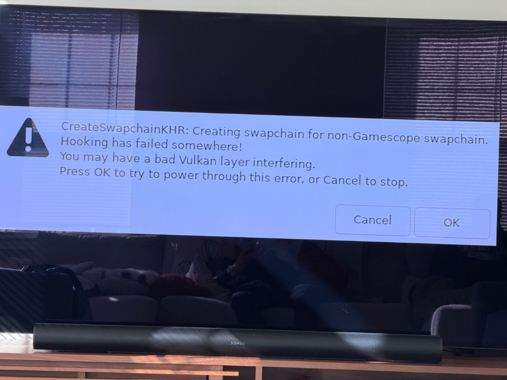
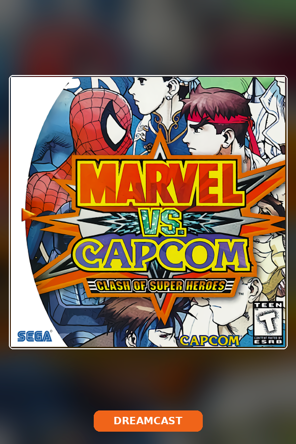
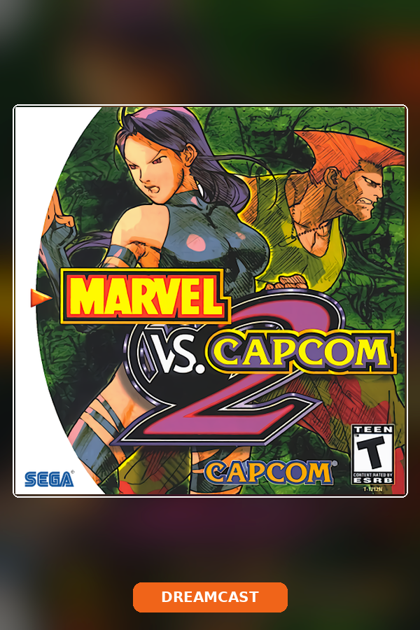

# Dreamcast (`org.flycast.Flycast`) — *Marvel vs. Capcom 2* `CreateSwapchainKHR` Gamescope Vulkan Layer Fix

<p align="center">
  
</p>

> [!IMPORTANT]
> ### TL;DR — What Broke, Why It Broke, and How We Fixed It
> - **The Problem**: Launching *Marvel vs. Capcom 2* (Dreamcast via Flatpak `org.flycast.Flycast`) in Steam Game Mode popped up:
>   `CreateSwapchainKHR: Creating swapchain for non-Gamescope swapchain. Hooking has failed somewhere! You may have a bad Vulkan layer interfering.`
> - **The Root Cause**: Steam Game Mode exports `ENABLE_GAMESCOPE_WSI=1`, which activates the Flatpak Vulkan layer `VK_LAYER_FROG_gamescope_wsi_x86_64` (`org.freedesktop.Platform.VulkanLayer.gamescope`). However, Flatpak's sandbox mounts a private `tmpfs` over `/run/user/1000` without the `/run/user/1000/gamescope-0` Wayland bypass socket. When Flycast initializes Vulkan (`pvr.rend=4`), the Gamescope layer fails to connect to `gamescope-0`, falls back to an Xwayland surface, and then halts in `vkCreateSwapchainKHR` because the surface is not a Gamescope surface.
> - **Bonus Bug Caught**: *Marvel vs. Capcom: Clash of Super Heroes* (`AppID 4081451232`) had accidentally been assigned the *Marvel vs. Capcom 2* (`AppID 2945344309`) box art in Steam due to a substring fallback collision in `harvest_hd_steam_artwork.py`, and `Marvel vs. Capcom 2 (Europe).chd` (`[T7010D 50]`) needed dynamic Europe region (`Dreamcast.Region=2`) detection while keeping 60 Hz NTSC (`Broadcast=0`) and VGA (`Cable=0`).
> - **The Permanent Fix**:
>   1. Enforced `DISABLE_GAMESCOPE_WSI=1` and `ENABLE_GAMESCOPE_WSI=0` across three layers: Flatpak overrides (`global` + `org.flycast.Flycast`, `info.cemu.Cemu`, `org.libretro.RetroArch`), wrapper script `export` statements, and explicit `/usr/bin/flatpak run --env=DISABLE_GAMESCOPE_WSI=1 --env=ENABLE_GAMESCOPE_WSI=0` flags.
>   2. Updated `flycast.sh` to auto-detect disc region tags case-insensitively (`(Europe)`/`(EUR)`/`(PAL)` -> `2`, `(Japan)`/`(JPN)`/`(JP)` -> `0`, `(USA)` -> `1`), ignore `#` comments/blank lines in `.m3u` playlists, and prefer `.chd` over stale `.cdi` files.
>   3. Restored genuine *Marvel vs. Capcom: Clash of Super Heroes* artwork in Steam and hardened `harvest_hd_steam_artwork.py` (`extract_sequel_tokens`) so sequel numbers (`1..10`, `i..x`) never collide across any of the 439 games.

## 1. Symptom Observed on Living-Room TV (`steammachine`)

When launching **Marvel vs. Capcom 2** (Sega Dreamcast via standalone Flatpak `org.flycast.Flycast`) from Steam Game Mode (`gamescope-session`), a modal error dialog blocks the screen before the game window appears:

```text
CreateSwapchainKHR: Creating swapchain for non-Gamescope swapchain.
Hooking has failed somewhere!
You may have a bad Vulkan layer interfering.
Press OK to try to power through this error, or Cancel to stop.
```

---

## 2. Forensic Root Cause Analysis

### Root Cause #1: Flatpak `VK_LAYER_FROG_gamescope_wsi_x86_64` Socket Isolation in Steam Game Mode

1. **Steam Game Mode Environment Inheritance**:
   When Steam runs inside `gamescope-session` on SteamOS (`steammachine` / `deck`), `/proc/$(pgrep -x steam)/environ` exports:
   ```text
   ENABLE_GAMESCOPE_WSI=1
   GAMESCOPE_WAYLAND_DISPLAY=gamescope-0
   DISPLAY=:0
   XDG_RUNTIME_DIR=/run/user/1000
   ```
    note that `WAYLAND_DISPLAY` is **not** set in the Gamescope session environment—only `GAMESCOPE_WAYLAND_DISPLAY=gamescope-0` (`/run/user/1000/gamescope-0`).

2. **Flatpak Vulkan Extension Activation**:
   On `steammachine`, the Flatpak runtime extensions `org.freedesktop.Platform.VulkanLayer.gamescope` (`24.08`, `25.08`, and `26.08`) are installed and mounted inside `org.flycast.Flycast` at `/usr/lib/extensions/vulkan/gamescope/share/vulkan/implicit_layer.d/VkLayer_FROG_gamescope_wsi.x86_64.json`:
   ```json
   {
     "file_format_version" : "1.0.0",
     "layer" : {
       "name": "VK_LAYER_FROG_gamescope_wsi_x86_64",
       "type": "GLOBAL",
       "library_path": "/usr/lib/extensions/vulkan/gamescope/lib/libVkLayer_FROG_gamescope_wsi_x86_64.so",
       "enable_environment": {
         "ENABLE_GAMESCOPE_WSI": "1"
       },
       "disable_environment": {
         "DISABLE_GAMESCOPE_WSI": "1"
       }
     }
   }
   ```

3. **Why Hooking Fails Inside the Flatpak `bwrap` Sandbox**:
   - Because `ENABLE_GAMESCOPE_WSI=1` is inherited into `flatpak run org.flycast.Flycast`, the Vulkan loader inside the Flatpak sandbox activates `VK_LAYER_FROG_gamescope_wsi_x86_64`.
   - However, Flatpak mounts an isolated `tmpfs` at `/run/user/1000` inside the container (containing only `.flatpak`, `app`, `bus`, `doc`, `flatpak-info`, `p11-kit`, `pulse`) and **does not** bind-mount `/run/user/1000/gamescope-0`.
   - When Flycast initializes its Vulkan renderer (`pvr.rend=4` on `RADV NAVI33`), `libVkLayer_FROG_gamescope_wsi_x86_64.so` attempts to connect to `gamescope-0` and fails:
     ```text
     [Gamescope WSI] Failed to connect to gamescope socket: gamescope-0. Bypass layer will be unavailable.
     ```
   - Surface creation (`vkCreateXcbSurfaceKHR` / `vkCreateXlibSurfaceKHR`) falls back to creating a standard Xwayland surface instead of a Gamescope WSI surface.
   - Immediately afterward, when Flycast calls `vkCreateSwapchainKHR`, `gamescope_wsi_CreateSwapchainKHR` checks whether the `VkSurfaceKHR` handle is registered in its internal Gamescope surface map, finds it missing while the layer is still loaded, and halts execution with the modal message box:
     `CreateSwapchainKHR: Creating swapchain for non-Gamescope swapchain. Hooking has failed somewhere!`

---

### Root Cause #2: Duplicate *Marvel vs. Capcom 2* Cover Art on *Marvel vs. Capcom: Clash of Super Heroes* (`AppID 4081451232` vs. `AppID 2945344309`) & PAL Region Tag

1. **Duplicate Box Art in `/home/deck/Games/media/dreamcast/covers/`**:
   - Inspecting `/home/deck/.local/share/Steam/logs/console_log.txt` at `12:04:50` and `12:05:22` revealed that clicking the first *Marvel vs. Capcom 2* poster in Steam actually launched `AppID 4081451232` (`Marvel vs. Capcom - Clash of Super Heroes (USA).chd`).
   - Why? Because `/home/deck/Games/media/dreamcast/covers/Marvel vs. Capcom - Clash of Super Heroes.png` (`517,752` bytes) was an accidental byte-for-byte duplicate of `Marvel vs. Capcom 2 (Europe).png` (`517,752` bytes), causing both shortcuts (`4081451232` and `2945344309`) to display the exact same *Marvel vs. Capcom 2* cover art in Steam Game Mode.
2. **Dynamic Region Matching for `Marvel vs. Capcom 2 (Europe).chd` (`[T7010D 50]`)**:
   - `Marvel vs. Capcom 2 (Europe).chd` has Dreamcast Product ID `T7010D 50` (Europe). Passing a hardcoded `-config config:Dreamcast.Region=1` (USA) caused Flycast to log:
     `00:00:591 emulator.cpp:218 N[BOOT]: USA region not supported. Using Europe instead`
   - `flycast.sh` now automatically inspects `$ROM_ARG` and sets `Dreamcast.Region=2` for `(Europe)` discs, `Dreamcast.Region=0` for `(Japan)` discs, and `Dreamcast.Region=1` for `(USA)` discs while keeping `Dreamcast.Broadcast=0` (NTSC 60 Hz) and `Dreamcast.Cable=0` (VGA 480p progressive scan).

---

## 3. The Permanent Fix

### A. Flatpak User Override (`/home/deck/.local/share/flatpak/overrides/org.flycast.Flycast`)
Also applied to `info.cemu.Cemu` and `org.libretro.RetroArch`:
```ini
[Context]
filesystems=/home/deck/Games;/run/udev:ro;
devices=all;

[Environment]
DISABLE_GAMESCOPE_WSI=1
ENABLE_GAMESCOPE_WSI=0
SDL_GAMECONTROLLER_ALLOW_STEAM_VIRTUAL_GAMEPAD=1
SDL_JOYSTICK_HIDAPI_STEAM=1
SDL_JOYSTICK_HIDAPI_STEAMDECK=1
SDL_JOYSTICK_ALLOW_BACKGROUND_EVENTS=1
SDL_GAMECONTROLLER_IGNORE_DEVICES=
```

### B. Self-Healing Launcher (`/home/deck/Games/launchers/flycast.sh`)
```bash
#!/usr/bin/env bash
if [ -x "/home/deck/Games/sync_saves.sh" ]; then "/home/deck/Games/sync_saves.sh" --pull >/dev/null 2>&1 || true; fi
export DISABLE_GAMESCOPE_WSI=1
export ENABLE_GAMESCOPE_WSI=0
export SDL_GAMECONTROLLER_IGNORE_DEVICES=""
export SDL_JOYSTICK_HIDAPI_STEAM=1
export SDL_JOYSTICK_HIDAPI_STEAMDECK=1
export SDL_JOYSTICK_ALLOW_BACKGROUND_EVENTS=1
if [ -f "/home/deck/Games/.master_config_backup/flycast/emu.cfg" ]; then
  mkdir -p /home/deck/.var/app/org.flycast.Flycast/config/flycast
  cp -f "/home/deck/Games/.master_config_backup/flycast/emu.cfg" /home/deck/.var/app/org.flycast.Flycast/config/flycast/emu.cfg
fi
ORIG_ARG="${1:-}"
ROM_ARG="$ORIG_ARG"
if [[ "$ROM_ARG" == *.m3u ]] && [ -f "$ROM_ARG" ]; then
  FIRST_DISC=$(grep -v '^[[:space:]]*#' "$ROM_ARG" | grep -v '^[[:space:]]*$' | head -n 1 | tr -d "\r\n")
  if [ -n "$FIRST_DISC" ]; then
    if [[ "$FIRST_DISC" == /* ]]; then
      ROM_ARG="$FIRST_DISC"
    else
      ROM_ARG="$(dirname "$ROM_ARG")/$FIRST_DISC"
    fi
  fi
fi
if [[ "$ROM_ARG" == *.cdi ]] && [ -f "${ROM_ARG%.cdi}.chd" ]; then
  ROM_ARG="${ROM_ARG%.cdi}.chd"
fi
DC_REGION=1
REGION_CHECK="${ORIG_ARG,,} ${ROM_ARG,,}"
case "$REGION_CHECK" in
  *"(europe"*|*"(eur"*|*"(pal"*)
    DC_REGION=2
    ;;
  *"(japan"*|*"(jpn"*|*"(jp"*)
    DC_REGION=0
    ;;
esac
/usr/bin/flatpak run \
  --env=DISABLE_GAMESCOPE_WSI=1 \
  --env=ENABLE_GAMESCOPE_WSI=0 \
  org.flycast.Flycast \
  -config audio:backend=alsa \
  -config config:aica.BufferSize=4096 \
  -config config:aica.AutoLatency=no \
  -config config:aica.DSPEnabled=no \
  -config config:pvr.rend=4 \
  -config config:rend.ThreadedRendering=yes \
  -config config:Dreamcast.Broadcast=0 \
  -config config:Dreamcast.Region="$DC_REGION" \
  -config config:Dreamcast.Cable=0 \
  -config window:fullscreen=yes \
  "$ROM_ARG"
if [ -x "/home/deck/Games/sync_saves.sh" ]; then nohup "/home/deck/Games/sync_saves.sh" --push >/dev/null 2>&1 & fi
```

### C. Restored Distinct Steam Grid Artwork (`4081451232` vs. `2945344309`)

| Title | Steam AppID | Restored Poster |
| :--- | :--- | :--- |
| **Marvel vs. Capcom: Clash of Super Heroes** (`USA`) | `4081451232` |  |
| **Marvel vs. Capcom 2: New Age of Heroes** (`Europe`) | `2945344309` |  |

---

## 4. Empirical Post-Fix Boot Log on `steammachine` (`RADV NAVI33`)

```text
00:00:000 sdl/sdl.cpp:899 N[RENDERER]: Monitor refresh rate: 60 Hz (3840 x 2160)
00:00:017 rend/vulkan/vulkan_context.cpp:303 N[RENDERER]: Vulkan API 1.1. Device AMD Steam Machine (RADV NAVI33)
00:00:017 rend/vulkan/vulkan_context.cpp:456 N[RENDERER]: Device extension enabled: VK_KHR_swapchain
00:00:021 rend/vulkan/vulkan_context.h:332 N[RENDERER]: Using depth format D32SfloatS8Uint tiling Optimal
00:00:154 ui/gui.cpp:245 N[RENDERER]: Screen DPI is 96, size 3840 x 2160. Scaling by 1.00
00:00:426 rend/vulkan/vulkan_renderer.cpp:246 N[RENDERER]: VulkanRenderer::Init
00:00:426 sdl/dreamlink.cpp:52 N[INPUT]: GUID: 03002854de2800000513000002006800 VID:28de PID:1305
00:00:426 sdl/sdl_gamepad.cpp:221 N[INPUT]: SDL: Opened joystick 0 on port 0: 'Steam Controller' unique_id=sdl_joystick_0
00:00:476 emulator.cpp:60 N[BOOT]: Game ID is [T7010D  50]
```
