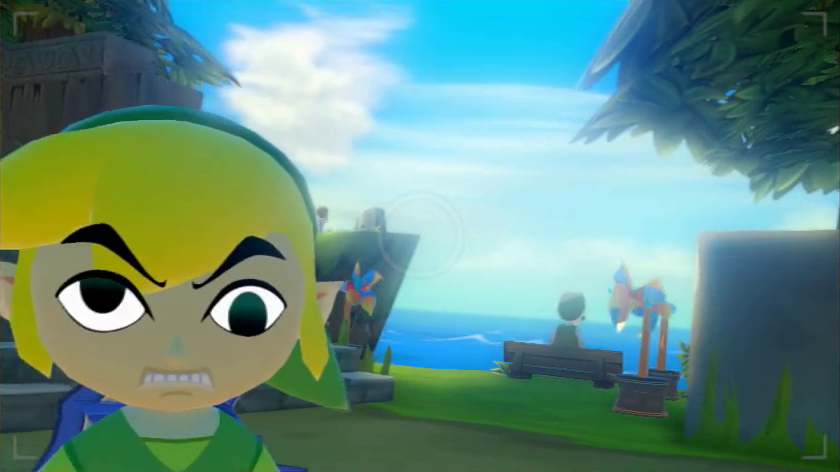
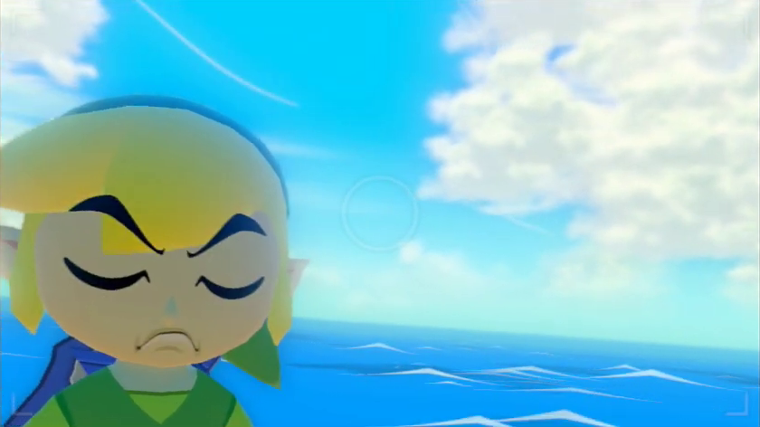

# SteamOS Emulation Works: Why Your Controller Stopped Working in *The Wind Waker HD* (and Why *Shenmue* Sounds Like a Blender on a 90 Hz OLED Steam Deck)

<p align="center">
  
</p>

<p align="center">
  <em>Actual live footage of my face when The Legend of Zelda: The Wind Waker HD boots in Steam Game Mode at 60 FPS, asks me to press A, and ignores every single button on the controller.</em>
</p>

---

> [!IMPORTANT]
> **Legal & Ownership Disclaimer**
>
> **I do not own any of the images, character likenesses, trademarks, hardware products, or emulator software referenced in this repository** (*The Legend of Zelda: The Wind Waker HD*, Link, Wii U, and Nintendo are trademarks of Nintendo Co., Ltd.; *Shenmue* and Dreamcast are trademarks of SEGA Corporation; Steam, SteamOS, Gamescope, Steam Deck, and Steam Controller are trademarks of Valve Corporation; Cemu, Flycast, and RetroArch belong to their respective open-source authors).
>
> **I DO, however, own a legitimate physical retail copy of *The Legend of Zelda: The Wind Waker HD*.**
>
> For the past few years since getting a Steam Deck, all I wanted to do was sit down and play *The Wind Waker HD* when I finally had 45 minutes of free time between work and family. Instead, it has been annoying me for years—and took over two to three months of active troubleshooting—because every time I sat down to play in SteamOS Game Mode, the controller mappings had either vanished, locked up on the Wii U GamePad prompt, or (in Dreamcast's case) turned *Shenmue* into a 90 Hz audio blender.
>
> I am publishing this forensic engineering breakdown and configuration kit publicly because I hunted everywhere across Reddit, GitHub Issues, forums, and wikis, and the actual root causes were not documented in one place anywhere on the internet. If you are out there with limited free time losing your mind over these exact same bugs, this repo is for you.

---

## Table of Contents

1. [The Crime Scene: What Was Breaking and Why Forum Advice Failed](#1-the-crime-scene-what-was-breaking-and-why-forum-advice-failed)
2. [Forensic Deep-Dive #1: The 5-Layer Cemu Controller Trap in SteamOS Game Mode](#2-forensic-deep-dive-1-the-5-layer-cemu-controller-trap-in-steamos-game-mode)
3. [Line-by-Line Anatomy of Every Cemu File (`v1.xml`, `Dummy-GamePad.xml`, `<TitleID>.ini`, `cemu.sh`)](#3-line-by-line-anatomy-of-every-cemu-file-v1xml-dummy-gamepadxml-titleidini-cemush)
4. [Forensic Deep-Dive #2: Why Standalone Flycast Rejects `.m3u` Playlists & Why *Shenmue* Audio Jitters on a 90 Hz OLED Steam Deck](#4-forensic-deep-dive-2-why-standalone-flycast-rejects-m3u-playlists--why-shenmue-audio-jitters-on-a-90-hz-oled-steam-deck)
5. [Line-by-Line Anatomy of Every Flycast File (`emu.cfg` and `flycast.sh`)](#5-line-by-line-anatomy-of-every-flycast-file-emucfg-and-flycastsh)
6. [Forensic Deep-Dive #3: Steam Binary `shortcuts.vdf`, CRC32 AppIDs, Collections & 4-Asset HD Grid Artwork](#6-forensic-deep-dive-3-steam-binary-shortcutsvdf-crc32-appids-collections--4-asset-hd-grid-artwork)
7. [Forensic Deep-Dive #4: Disabling Steam Remote Play & macOS Sequoia Remote `sshd` TCC Popups](#7-forensic-deep-dive-4-disabling-steam-remote-play--macos-sequoia-remote-sshd-tcc-popups)

---

## 1. The Crime Scene: What Was Breaking and Why Forum Advice Failed

If you set up standalone Flatpak emulators (`info.cemu.Cemu`, `org.flycast.Flycast`) on an **OLED Steam Deck** or a living-room **SteamOS / Steam Machine** box and launch games directly from **Steam Game Mode (Gamescope)**, you eventually hit three infuriating walls:

1. **The Cemu Amnesia Bug**: You configure your controller in Desktop Mode, test *The Wind Waker HD*, and it works. Then you switch to Steam Game Mode, launch the game, and **zero buttons work**. Or worse: it works *once*, you exit the game, launch it again tomorrow, and Cemu has silently wiped your `controller0.xml` back to an empty file.
2. **The Multi-Device UUID Collision**: If you sync your configs between a handheld **OLED Steam Deck** and a docked **SteamOS box** with a wireless **Steam Controller**, fixing the controller on one device immediately breaks it on the other—even if you try putting both `<controller>` blocks inside the same `v1.xml`.
3. **The *Shenmue* Triple Whammy**:
   - Clicking a multi-disc `.m3u` playlist in standalone Flycast crashes immediately with `E[BOOT]: Unknown disk format`.
   - Half the "ready-to-play" `.cdi` packs on Archive.org (`Sega_Dreamcast-Batocera`) are secretly 2001 Russian pirate translations (`МЕНЮ СТАРТ`).
   - When you finally load a clean verified USA `.chd` (`Shenmue (USA) (Disc 1).chd`) on an **OLED Steam Deck**, the audio stutters and jitters exactly 30 times per second like Ryo Hazuki is speaking through a ceiling fan.

Here is how we diagnosed the exact root cause of every single one of those issues using C++ source inspection, binary symbol analysis, and PipeWire audio telemetry—and the exact files that lock them down permanently.

---

## 2. Forensic Deep-Dive #1: The 5-Layer Cemu Controller Trap in SteamOS Game Mode

<p align="center">
  
</p>

<p align="center">
  <em>When Cemu's InputManager::save() overwrites your controller0.xml on exit for the 4th time in one evening.</em>
</p>

Instead of guessing in the GUI, we inspected Cemu's input subsystem source code (`src/input/emulated/EmulatedController.cpp` and `src/input/InputManager.cpp`) and the environment variables injected by SteamOS `gamescope-session`. We found **five separate traps** that must all be solved simultaneously:

### Trap 1: Steam Game Mode Injects `SDL_GAMECONTROLLER_IGNORE_DEVICES`
- **How we found it**: Inspecting `/proc/<pid>/environ` of a non-Steam shortcut launched by Steam Game Mode (`gamescope`) showed that Steam populates `SDL_GAMECONTROLLER_IGNORE_DEVICES` with the vendor/product IDs of physical controllers so games don't double-read raw evdev alongside Steam Input.
- **Why it breaks Flatpak Cemu**: Inside the `info.cemu.Cemu` Flatpak sandbox, inheriting `SDL_GAMECONTROLLER_IGNORE_DEVICES` causes SDL2's `SDL_GameControllerOpen()` to ignore the active Steam Virtual Gamepad completely.
- **The Fix**: Explicitly clear `SDL_GAMECONTROLLER_IGNORE_DEVICES=""` and enable Steam HIDAPI (`SDL_JOYSTICK_HIDAPI_STEAM=1`, `SDL_JOYSTICK_HIDAPI_STEAMDECK=1`, `SDL_JOYSTICK_ALLOW_BACKGROUND_EVENTS=1`) in both `/home/deck/.local/share/flatpak/overrides/info.cemu.Cemu` and the `/home/deck/Games/launchers/cemu.sh` wrapper script.

### Trap 2: Cemu's `EmulatedController::set_mapping` Only Allows ONE `<controller>` Block Per XML File
- **How we found it**: We tried putting two `<controller>` blocks inside `v1.xml`—one for the Steam Machine (`<uuid>0_03002854de2800000513000002006800</uuid>`) and one for the OLED Steam Deck (`<uuid>0_030079f6de280000ff11000001000000</uuid>`). It broke the first device every time.
- **Why it happens in Cemu's C++ source**: In `src/input/emulated/EmulatedController.cpp`, `EmulatedController::set_mapping` stores button bindings in a single-value map indexed by the Wii U button ID (`1..25`):
  ```cpp
  m_mappings[mapping] = { controller, button };
  ```
  When Cemu parses an XML profile with two `<controller>` blocks that both define `<mapping>1</mapping>` through `<mapping>25</mapping>`, the second `<controller>` block **unconditionally overwrites** the first `<controller>` block's pointers in `m_mappings`!
- **The Fix**: Never put two `<controller>` blocks in one Cemu XML file. Each host must get its own single-controller `v1.xml`:
  - **OLED Steam Deck (`steamdeck`)**:
    - `<api>SDLController</api>`
    - `<uuid>0_030079f6de280000ff11000001000000</uuid>`
    - `<display_name>Steam Virtual Gamepad</display_name>`
  - **SteamOS Living-Room Box (`steammachine` with wireless Steam Controller)**:
    - `<api>SDLController</api>`
    - `<uuid>0_03002854de2800000513000002006800</uuid>`
    - `<display_name>Steam Controller</display_name>`

### Trap 3: Cemu Overwrites `controller0.xml` on Exit Unless Locked by `gameProfiles/<TitleID>.ini`
- **How we found it**: Even with a valid `controller0.xml`, exiting a game when a wireless controller was asleep or switching between Desktop and Game Mode caused Cemu to overwrite `controller0.xml` on shutdown.
- **Why it happens in Cemu's C++ source**: In `src/input/InputManager.cpp`, `InputManager::save()` serializes the current runtime state back to `controller0.xml` on exit—**unless** `m_is_gameprofile_set[index]` is `true` because the running game's `gameProfiles/<TitleID>.ini` explicitly loaded a named profile (`controller1 = v1`)!
- **The Fix**: Save the mapping as both `v1.xml` and `controller0.xml`, and create `/home/deck/.var/app/info.cemu.Cemu/config/Cemu/gameProfiles/0005000010143500.ini` (the USA TitleID for *The Legend of Zelda: The Wind Waker HD*) locking `controller1 = v1`.

### Trap 4: The Wii U GamePad vs. Pro Controller Prompt in *The Wind Waker HD*
- **How we found it**: *The Wind Waker HD* checks at startup whether a Wii U GamePad or a Wii U Pro Controller is connected. If Player 1 is a `Wii U GamePad`, pressing the `-` (Select) button toggles Cemu's DRC (GamePad screen) view or locks you into gyro aiming unless disabled. If Player 1 is a `Wii U Pro Controller`, some Wii U titles complain if no `Wii U GamePad` exists on the bus at all.
- **The Fix**:
  - Set `v1.xml` (Player 1) to `<type>Wii U Pro Controller</type>` with `<motion>false</motion>`.
  - Create `Dummy-GamePad.xml` (Player 2) as `<type>Wii U GamePad</type>` with **no `<controller>` block bound** and `<toggle_display>0</toggle_display>`.
  - In `gameProfiles/0005000010143500.ini`, set:
    ```ini
    [Controller]
    controller1 = v1
    controller2 = Dummy-GamePad
    ```
  Now *The Wind Waker HD* sees a valid `Wii U Pro Controller` on Player 1 and a passive `Wii U GamePad` on Player 2, automatically selects **Pro Controller Mode** on the title screen, and never nags or flips screens.

### Trap 5: Sentinel File Collisions & Pre-Launch Self-Healing
- **How we found it**: Initially, our deployment script checked `if os.path.exists("/home/deck/steammachine"):` to decide which UUID to write. When a stray file named `/home/deck/steammachine` was accidentally created on the OLED Steam Deck during an `scp` command, running the script on the OLED Steam Deck caused it to think it was the Steam Machine and overwrite its own `v1.xml` with the wrong UUID!
- **The Fix**:
  1. Detect the host strictly via `socket.gethostname().strip().lower() == "steammachine"`.
  2. Store a pristine golden copy of `controllerProfiles/` and `gameProfiles/` in `/home/deck/Games/.master_config_backup/cemu/` and have `cemu.sh` copy them back into `~/.var/app/info.cemu.Cemu/config/Cemu/` and `data/Cemu/` **before every single game launch**. Even if you open Cemu's GUI and mash Delete on every profile, the next time you click *The Wind Waker HD* in Steam, it heals itself in 5 milliseconds before Cemu even opens.

---

## 3. Line-by-Line Anatomy of Every Cemu File (`v1.xml`, `Dummy-GamePad.xml`, `<TitleID>.ini`, `cemu.sh`)

### File 1: `configs/cemu/oled_steam_deck/controllerProfiles/v1.xml`
Installed to:
- `/home/deck/.var/app/info.cemu.Cemu/config/Cemu/controllerProfiles/v1.xml`
- `/home/deck/.var/app/info.cemu.Cemu/config/Cemu/controllerProfiles/controller0.xml`
- `/home/deck/.var/app/info.cemu.Cemu/data/Cemu/controllerProfiles/v1.xml`
- `/home/deck/Games/.master_config_backup/cemu/controllerProfiles/v1.xml`

```xml
<?xml version="1.0" encoding="UTF-8"?>
<emulated_controller>
	<type>Wii U Pro Controller</type>
	<profile>v1</profile>
	<controller>
		<api>SDLController</api>
		<uuid>0_030079f6de280000ff11000001000000</uuid>
		<display_name>Steam Virtual Gamepad</display_name>
		<motion>false</motion>
		<rumble>0</rumble>
		<axis>
			<deadzone>0.25</deadzone>
			<range>1</range>
		</axis>
		<rotation>
			<deadzone>0.25</deadzone>
			<range>1</range>
		</rotation>
		<trigger>
			<deadzone>0.25</deadzone>
			<range>1</range>
		</trigger>
		<mappings>
			<entry><mapping>1</mapping><button>1</button></entry>
			<entry><mapping>2</mapping><button>0</button></entry>
			<entry><mapping>3</mapping><button>3</button></entry>
			<entry><mapping>4</mapping><button>2</button></entry>
			<entry><mapping>5</mapping><button>9</button></entry>
			<entry><mapping>6</mapping><button>10</button></entry>
			<entry><mapping>7</mapping><button>42</button></entry>
			<entry><mapping>8</mapping><button>43</button></entry>
			<entry><mapping>9</mapping><button>6</button></entry>
			<entry><mapping>10</mapping><button>4</button></entry>
			<entry><mapping>11</mapping><button>5</button></entry>
			<entry><mapping>12</mapping><button>11</button></entry>
			<entry><mapping>13</mapping><button>12</button></entry>
			<entry><mapping>14</mapping><button>13</button></entry>
			<entry><mapping>15</mapping><button>14</button></entry>
			<entry><mapping>16</mapping><button>7</button></entry>
			<entry><mapping>17</mapping><button>8</button></entry>
			<entry><mapping>18</mapping><button>45</button></entry>
			<entry><mapping>19</mapping><button>39</button></entry>
			<entry><mapping>20</mapping><button>44</button></entry>
			<entry><mapping>21</mapping><button>38</button></entry>
			<entry><mapping>22</mapping><button>47</button></entry>
			<entry><mapping>23</mapping><button>41</button></entry>
			<entry><mapping>24</mapping><button>46</button></entry>
			<entry><mapping>25</mapping><button>40</button></entry>
		</mappings>
	</controller>
</emulated_controller>
```

#### What Every Element in `v1.xml` Does:

| XML Element | Value | Technical Meaning in Cemu |
| :--- | :--- | :--- |
| `<type>` | `Wii U Pro Controller` | Emulates a native Wii U Pro Controller (`WPAD_EXT_PRO_CONTROLLER`) instead of the bulky DRC GamePad, disabling second-screen touch/gyro prompts in *The Wind Waker HD*. |
| `<profile>` | `v1` | Internal profile identifier referenced by `controller1 = v1` inside `gameProfiles/<TitleID>.ini`. |
| `<api>` | `SDLController` | Uses Cemu's SDL2 GameController backend (`SDLControllerProvider.cpp`), which reads Steam Input's virtual XInput/Gamepad device inside Gamescope. |
| `<uuid>` | `0_030079f6de280000ff11000001000000` *(OLED Deck)*<br>`0_03002854de2800000513000002006800` *(Steam Controller)* | Prefix `0_` = controller index `0` on that SDL GUID. `030079f6de280000ff11000001000000` is Valve's `Steam Virtual Gamepad` (`VID 0x28de`, `PID 0x11ff`). `03002854de2800000513000002006800` is Valve's `Steam Controller` (`VID 0x28de`, `PID 0x1305`). |
| `<motion>` | `false` | Prevents unintended gyro drift on handheld movement. |
| `<deadzone>` / `<range>` | `0.25` / `1` | Applies a 25% radial deadzone and 100% outer range to left stick (`<axis>`), right stick (`<rotation>`), and analog triggers (`<trigger>`). |

#### Complete 25-Button Mapping Table (`<mapping>` vs. `<button>`):

Because Nintendo puts `A` on the right and `B` on the bottom (whereas Xbox/Steam Input puts `B` on the right and `A` on the bottom), Cemu's `<mapping>` IDs map to SDL2's `SDL_GameControllerButton` and axis thresholds as follows:

| Cemu `<mapping>` ID | Wii U Pro Controller Control | Cemu `<button>` Value | Physical Steam Deck / SDL2 Input |
| :---: | :--- | :---: | :--- |
| `1` | **Wii U `A` Button** (Confirm / East) | `1` | `SDL_CONTROLLER_BUTTON_B` (Physical **B / East** button, matching Nintendo physical layout) |
| `2` | **Wii U `B` Button** (Cancel / South) | `0` | `SDL_CONTROLLER_BUTTON_A` (Physical **A / South** button) |
| `3` | **Wii U `X` Button** (North) | `3` | `SDL_CONTROLLER_BUTTON_Y` (Physical **Y / North** button) |
| `4` | **Wii U `Y` Button** (West) | `2` | `SDL_CONTROLLER_BUTTON_X` (Physical **X / West** button) |
| `5` | **Wii U `L` Bumper** | `9` | `SDL_CONTROLLER_BUTTON_LEFTSHOULDER` (`L1`) |
| `6` | **Wii U `R` Bumper** | `10` | `SDL_CONTROLLER_BUTTON_RIGHTSHOULDER` (`R1`) |
| `7` | **Wii U `ZL` Trigger** | `42` | Cemu SDL Axis `+4` (`SDL_CONTROLLER_AXIS_TRIGGERLEFT` positive threshold, `L2`) |
| `8` | **Wii U `ZR` Trigger** | `43` | Cemu SDL Axis `+5` (`SDL_CONTROLLER_AXIS_TRIGGERRIGHT` positive threshold, `R2`) |
| `9` | **Wii U `+` (Start)** | `6` | `SDL_CONTROLLER_BUTTON_START` (`Menu / +`) |
| `10` | **Wii U `-` (Select)** | `4` | `SDL_CONTROLLER_BUTTON_BACK` (`View / -`) |
| `11` | **Wii U `Home`** | `5` | `SDL_CONTROLLER_BUTTON_GUIDE` |
| `12` | **D-Pad Up** | `11` | `SDL_CONTROLLER_BUTTON_DPAD_UP` |
| `13` | **D-Pad Down** | `12` | `SDL_CONTROLLER_BUTTON_DPAD_DOWN` |
| `14` | **D-Pad Left** | `13` | `SDL_CONTROLLER_BUTTON_DPAD_LEFT` |
| `15` | **D-Pad Right** | `14` | `SDL_CONTROLLER_BUTTON_DPAD_RIGHT` |
| `16` | **Left Stick Click (`L3`)** | `7` | `SDL_CONTROLLER_BUTTON_LEFTSTICK` |
| `17` | **Right Stick Click (`R3`)** | `8` | `SDL_CONTROLLER_BUTTON_RIGHTSTICK` |
| `18` | **Left Stick Up** | `45` | Cemu SDL Axis `-1` (`LEFTY` negative = Up) |
| `19` | **Left Stick Down** | `39` | Cemu SDL Axis `+1` (`LEFTY` positive = Down) |
| `20` | **Left Stick Left** | `44` | Cemu SDL Axis `-0` (`LEFTX` negative = Left) |
| `21` | **Left Stick Right** | `38` | Cemu SDL Axis `+0` (`LEFTX` positive = Right) |
| `22` | **Right Stick Up** | `47` | Cemu SDL Axis `-3` (`RIGHTY` negative = Up) |
| `23` | **Right Stick Down** | `41` | Cemu SDL Axis `+3` (`RIGHTY` positive = Down) |
| `24` | **Right Stick Left** | `46` | Cemu SDL Axis `-2` (`RIGHTX` negative = Left) |
| `25` | **Right Stick Right** | `40` | Cemu SDL Axis `+2` (`RIGHTX` positive = Right) |

*(Note how Cemu encodes SDL axes as virtual button IDs: `38..43` are positive axes `0..5`, and `44..49` are negative axes `0..5`!)*

### File 2: `configs/cemu/oled_steam_deck/controllerProfiles/Dummy-GamePad.xml`
Installed to `Dummy-GamePad.xml` and `controller1.xml`:
```xml
<?xml version="1.0" encoding="UTF-8"?>
<emulated_controller>
	<type>Wii U GamePad</type>
	<profile>Dummy-GamePad</profile>
	<toggle_display>0</toggle_display>
</emulated_controller>
```
- **`<type>Wii U GamePad</type>` with no `<controller>` child**: Tells the emulated Wii U OS that a GamePad is connected on port 2 so games that require a GamePad to exist don't throw an error banner, while keeping 100% of physical inputs routed to Player 1's `Wii U Pro Controller`.
- **`<toggle_display>0</toggle_display>`**: Disables the Tab/Minus screen-swap hotkey so you never accidentally flip into the blank DRC sub-screen mid-boss-fight.

### File 3: `configs/cemu/gameProfiles/0005000010143500.ini`
Installed to `/home/deck/.var/app/info.cemu.Cemu/config/Cemu/gameProfiles/0005000010143500.ini`:
```ini
[Controller]
controller1 = v1
controller2 = Dummy-GamePad
```
- **`0005000010143500`**: The 64-bit Wii U TitleID for *The Legend of Zelda: The Wind Waker HD* (USA). (Use `0005000010143400` for JPN and `0005000010143600` for EUR).
- **`controller1 = v1`**: Forces Cemu to load `v1.xml` for Player 1 and sets `m_is_gameprofile_set[0] = true` so Cemu never overwrites `controller0.xml` on exit.

### File 4: `launchers/cemu.sh`
Installed to `/home/deck/Games/launchers/cemu.sh`:
```bash
#!/usr/bin/env bash
if [ -x "/home/deck/Games/sync_saves.sh" ]; then "/home/deck/Games/sync_saves.sh" --pull >/dev/null 2>&1 || true; fi
if [ -d "/home/deck/Games/.master_config_backup/cemu" ]; then
  cp -rf /home/deck/Games/.master_config_backup/cemu/* /home/deck/.var/app/info.cemu.Cemu/config/Cemu/ 2>/dev/null || true
  cp -rf /home/deck/Games/.master_config_backup/cemu/* /home/deck/.var/app/info.cemu.Cemu/data/Cemu/ 2>/dev/null || true
fi
export SDL_GAMECONTROLLER_IGNORE_DEVICES=""
export SDL_JOYSTICK_HIDAPI_STEAM=1
export SDL_JOYSTICK_HIDAPI_STEAMDECK=1
export SDL_JOYSTICK_ALLOW_BACKGROUND_EVENTS=1
/usr/bin/flatpak run info.cemu.Cemu -f -g "$1"
if [ -x "/home/deck/Games/sync_saves.sh" ]; then nohup "/home/deck/Games/sync_saves.sh" --push >/dev/null 2>&1 & fi
```

---

## 4. Forensic Deep-Dive #2: Why Standalone Flycast Rejects `.m3u` Playlists & Why *Shenmue* Audio Jitters on a 90 Hz OLED Steam Deck

### Step 1: Why Clicking *Shenmue* Did Nothing (`Unknown disk format`)
When we ran standalone Flycast (`org.flycast.Flycast`) under Gamescope against `/home/deck/Games/Dreamcast/roms/Shenmue.m3u`, Flycast's stderr logged:
```text
00:00:726 ui/gui.cpp:1318 E[BOOT]: Unknown disk format
00:00:726 ui/gui.cpp:484 E[COMMON]: Flycast has stopped: Unknown disk format
```
Unlike the RetroArch `flycast_libretro` core, standalone `org.flycast.Flycast` does not parse `.m3u` playlist files! Furthermore, if you change your Steam shortcut target from `Shenmue.m3u` to `Shenmue (Disc 1).chd`, you would have to restart Steam or re-compute AppIDs.
- **The Fix**: Inside `flycast.sh`, intercept any `*.m3u` argument, strip Windows `\r\n` line endings, read line 1 (`Shenmue (Disc 1).chd`), and pass the resolved disc path directly to `org.flycast.Flycast`.

### Step 2: Why *Shenmue* Booted in Russian (`МЕНЮ СТАРТ`)
If you ever downloaded Dreamcast packs from `archive.org/download/Sega_Dreamcast-Batocera/` (`Shenmue.zip`, `Jet%20Set%20Radio.zip`), running `strings` on those `.cdi` files reveals:
```text
SEGA SEGAKATANA SEGA ENTERPRISES6F25 GD-ROM1/2 JUE E001E10 Ps2Sega.ruV1.00020010306 1ST_READ.BIN SELFBOOT
```
Those `.cdi` files are Russian pirate/fan translations (`Ps2Sega.ru`). Always source Dreamcast images from the verified Redump USA `.chd` collection (`sega-dreamcast-redump-collection`), where `Shenmue (USA) (Disc 1).chd` is `395.8 MB` (`415,053,669` bytes, `MD5: 13268ae2c86077cef8850c871d80fc49`, Game ID `MK-51059`).

### Step 3: Why the USA Version Had Severe Audio Jitter on the 90 Hz OLED Steam Deck (The `17.41 ms` vs. `22.22 ms` Proof)
Once `Shenmue (USA) (Disc 1).chd` booted on the **OLED Steam Deck**, the audio crackled and jittered continuously. Why?

1. **We inspected PipeWire's active sink-inputs (`pactl list sink-inputs`) while Flycast was running with its default `audio:backend=auto` (`pulse`)**:
   ```text
   Sink Input #200
       Sample Specification: s16le 2ch 44100Hz
       Resample method: PipeWire
           application.name = "flycast"
           media.name = "Audio Stream"
           node.latency = "256/44100"
           pulse.attr.maxlength = "4194304"
           pulse.attr.tlength = "3072"
           pulse.attr.prebuf = "2052"
           pulse.attr.minreq = "1024"
   ```
2. **We inspected the `org.flycast.Flycast` ELF binary (`core/audio/audiobackend_pulseaudio.cpp` vs. `core/audio/audiobackend_alsa.cpp`)**:
   - In `audiobackend_pulseaudio.cpp`, Flycast's `PulseAudioBackend` **completely ignores `aica.BufferSize` in `emu.cfg`** and hardcodes `buffer_attr.tlength = 3 * 1024` (`3072` bytes).
   - At 16-bit stereo (`4` bytes per sample frame) and `44,100 Hz`:
     $$\text{Total Buffer} = \frac{3072\text{ bytes}}{4\text{ bytes/sample}} = 768\text{ samples} = \frac{768}{44100}\text{ s} = \mathbf{17.41\text{ ms}}$$
     $$\text{PipeWire Quantum (`minreq`)} = \frac{1024\text{ bytes}}{4\text{ bytes/sample}} = 256\text{ samples} = \mathbf{5.80\text{ ms}}$$
3. **Now compare that `17.41 ms` buffer against the 90 Hz OLED Steam Deck display**:
   - Flycast's boot log on the OLED Steam Deck reports:
     `00:00:000 sdl/sdl.cpp:899 N[RENDERER]: Monitor refresh rate: 90 Hz (1280 x 800)`
   - At **90 Hz**, each display VSync tick occurs every **`11.11 ms`**.
   - *Shenmue (USA)* is a **60 Hz NTSC** game, producing one frame every **`16.67 ms`**.
   - When a 60 FPS game is VSync-paced onto a 90 Hz display (`3:2` pulldown cadence), every odd frame waits **1 VSync (`11.11 ms`)** and every even frame waits **2 VSyncs (`22.22 ms`)** (averaging `16.67 ms`).
   - Because **`22.22 ms > 17.41 ms`**, on every single 2-VSync frame (`30 times per second`), Flycast's emulation thread waits `22.22 ms` for VSync while the `17.41 ms` (`3072`-byte) PulseAudio buffer **completely drains and underruns**!
4. **The Fix (`audio:backend=alsa` + `aica.BufferSize=4096` + `pvr.rend=4` Vulkan)**:
   - Unlike `audiobackend_pulseaudio.cpp`, Flycast's `AlsaAudioBackend` (`audiobackend_alsa.cpp`, routed cleanly through PipeWire's ALSA plugin on SteamOS) actually reads `aica.BufferSize`!
   - When we launched Flycast with `-config audio:backend=alsa -config config:aica.BufferSize=4096 -config config:aica.AutoLatency=no`, `pactl list sink-inputs` immediately changed to:
     ```text
     Sink Input #207
         Sample Specification: s16le 2ch 44100Hz
         Resample method: PipeWire
             application.name = "ALSA plug-in [flycast]"
             media.name = "ALSA Playback"
             node.latency = "661/44100"
             pulse.attr.maxlength = "4194304"
             pulse.attr.tlength = "10584"
             pulse.attr.prebuf = "7944"
             pulse.attr.minreq = "2644"
     ```
   - Look at the new buffer math:
     $$\text{Total Buffer (`tlength`)} = \frac{10584\text{ bytes}}{4\text{ bytes/sample}} = 2646\text{ samples} = \mathbf{60.00\text{ ms}}$$
     $$\text{Prebuffer (`prebuf`)} = \frac{7944\text{ bytes}}{4\text{ bytes/sample}} = 1986\text{ samples} = \mathbf{45.03\text{ ms}}$$
   - Because **`60.00 ms >> 22.22 ms`**, the buffer never underruns during 90 Hz VSync pacing, and switching `pvr.rend` from `0` (OpenGL 4.6) to `4` (Vulkan) + `aica.DSPEnabled = no` eliminates synchronous shader and x64 Yamaha AICA DSP recompilation stalls.

---

## 5. Line-by-Line Anatomy of Every Flycast File (`emu.cfg` and `flycast.sh`)

### File 1: `configs/flycast/emu.cfg`
Installed to `/home/deck/.var/app/org.flycast.Flycast/config/flycast/emu.cfg` and `/home/deck/Games/.master_config_backup/flycast/emu.cfg`:
```ini
[audio]
backend = alsa

[config]
Dreamcast.Broadcast = 0
Dreamcast.Cable = 0
Dreamcast.ContentPath = /home/deck/Games/Dreamcast/roms
Dreamcast.Language = 1
Dreamcast.Region = 1
aica.AutoLatency = no
aica.BufferSize = 4096
aica.DSPEnabled = no
pvr.rend = 4
rend.ThreadedRendering = yes
rend.vsync = yes

[window]
fullscreen = yes
height = 800
left = 0
maximized = no
top = 0
width = 1280
```

| Section & Key | Value | Exact Purpose |
| :--- | :--- | :--- |
| `[audio] backend` | `alsa` | Uses `AlsaAudioBackend` (`ALSA plug-in [flycast]` via PipeWire) instead of `PulseAudioBackend` so `aica.BufferSize` is honored (`10584`-byte / `60.0 ms` buffer instead of hardcoded `3072`-byte / `17.41 ms` buffer). |
| `[config] Dreamcast.Broadcast` | `0` | Forces **NTSC 60 Hz** broadcast timing (`0` = NTSC, `1` = PAL 50 Hz), even if `dc_flash.bin` has a European factory record (`00211Dreamcast`). |
| `[config] Dreamcast.Cable` | `0` | Connects virtual **VGA Box (`0` = VGA 480p 60 Hz progressive scan)** instead of interlaced composite. |
| `[config] Dreamcast.Region` | `1` | Sets console region to **North America / USA (`1`)** (`0` = Japan, `1` = USA, `2` = Europe). |
| `[config] Dreamcast.Language` | `1` | Sets BIOS language to **English (`1`)**. |
| `[config] aica.AutoLatency` | `no` | Prevents Flycast from shrinking the audio buffer back down to minimum latency. |
| `[config] aica.BufferSize` | `4096` | Allocates a 4096-sample AICA buffer (`60.0 ms` in PipeWire ALSA), absorbing 90 Hz OLED 2-VSync (`22.22 ms`) frame intervals without underruns. |
| `[config] aica.DSPEnabled` | `no` | Disables real-time x64 JIT recompilation of Yamaha AICA DSP reverb microcode (`core/hw/aica/dsp_x64.cpp`), which causes CPU spikes during *Shenmue* rain cutscenes. |
| `[config] pvr.rend` | `4` | Selects **Vulkan Per-Triangle (`4`)** (`RADV VANGOGH` / `RADV NAVI33`) instead of `0` (OpenGL 4.6), avoiding synchronous GLSL shader compilation pauses. |
| `[config] rend.ThreadedRendering` | `yes` | Decouples PowerVR2 GPU rendering onto a dedicated thread so SH-4 / AICA audio emulation never stalls waiting for the GPU. |
| `[window] fullscreen` | `yes` | Forces borderless fullscreen inside Gamescope. |

### File 2: `launchers/flycast.sh`
Installed to `/home/deck/Games/launchers/flycast.sh`:
```bash
#!/usr/bin/env bash
if [ -x "/home/deck/Games/sync_saves.sh" ]; then "/home/deck/Games/sync_saves.sh" --pull >/dev/null 2>&1 || true; fi
export SDL_GAMECONTROLLER_IGNORE_DEVICES=""
export SDL_JOYSTICK_HIDAPI_STEAM=1
export SDL_JOYSTICK_HIDAPI_STEAMDECK=1
export SDL_JOYSTICK_ALLOW_BACKGROUND_EVENTS=1
if [ -f "/home/deck/Games/.master_config_backup/flycast/emu.cfg" ]; then
  cp -f "/home/deck/Games/.master_config_backup/flycast/emu.cfg" /home/deck/.var/app/org.flycast.Flycast/config/flycast/emu.cfg
fi
ROM_ARG="$1"
if [[ "$ROM_ARG" == *.m3u ]] && [ -f "$ROM_ARG" ]; then
  FIRST_DISC=$(head -n 1 "$ROM_ARG" | tr -d "\r\n")
  ROM_ARG="$(dirname "$ROM_ARG")/$FIRST_DISC"
fi
if [[ "$ROM_ARG" == *.cdi ]] && [ ! -f "$ROM_ARG" ] && [ -f "${ROM_ARG%.cdi}.chd" ]; then
  ROM_ARG="${ROM_ARG%.cdi}.chd"
fi
/usr/bin/flatpak run org.flycast.Flycast \
  -config audio:backend=alsa \
  -config config:aica.BufferSize=4096 \
  -config config:aica.AutoLatency=no \
  -config config:aica.DSPEnabled=no \
  -config config:pvr.rend=4 \
  -config config:rend.ThreadedRendering=yes \
  -config config:Dreamcast.Broadcast=0 \
  -config config:Dreamcast.Region=1 \
  -config config:Dreamcast.Cable=0 \
  -config window:fullscreen=yes \
  "$ROM_ARG"
if [ -x "/home/deck/Games/sync_saves.sh" ]; then nohup "/home/deck/Games/sync_saves.sh" --push >/dev/null 2>&1 & fi
```

---

## 6. Forensic Deep-Dive #3: Steam Binary `shortcuts.vdf`, CRC32 AppIDs, Collections & 4-Asset HD Grid Artwork

When injecting non-Steam games into Steam (`userdata/<steam3_id>/config/shortcuts.vdf`), getting the cover art and Collections (`cloud-storage-namespace-1.json`) to show up in Steam Game Mode requires matching Valve's exact binary schema and CRC32 bitmask:

1. **Deterministic Non-Steam AppID Formula**:
   ```python
   import zlib

   def compute_appid(exe: str, appname: str) -> int:
       raw = f"{exe}{appname}".encode("utf-8")
       return (zlib.crc32(raw) & 0xFFFFFFFF) | 0x80000000
   ```
   - `exe` must include its surrounding quotes if written with quotes in `shortcuts.vdf` (or `"/usr/bin/bash"` when using a bash dispatcher).
   - Setting bit 31 (`| 0x80000000`) marks the 32-bit unsigned integer as a non-Steam shortcut AppID.
2. **Binary `shortcuts.vdf` Type Bytes**:
   - `\x00` + `key\x00`: Start of nested dictionary/map (`shortcuts`, `<index>`, `tags`)
   - `\x01` + `key\x00` + `value\x00`: Null-terminated UTF-8 string (`AppName`, `Exe`, `StartDir`, `icon`, `ShortcutPath`, `LaunchOptions`, `FlatpakAppID`)
   - `\x02` + `key\x00` + `<4-byte uint32 little-endian>`: 32-bit integer (`appid`, `IsHidden`, `AllowDesktopConfig`, `AllowOverlay`, `OpenVR`, `Devkit`, `LastPlayTime`)
   - `\x08`: End of current dictionary/map
3. **4-Asset Steam Grid Artwork Filenames (`userdata/<steam3_id>/config/grid/`)**:
   For a given unsigned 32-bit `<appid>`:
   - **`<appid>p.png` (`600x900`)**: Vertical library capsule/poster (notice the lowercase `p` suffix!).
   - **`<appid>.png` (`920x430`)**: Wide horizontal capsule (shown in Recent Games / Home carousel).
   - **`<appid>_hero.png` (`1920x620`)**: Top background banner on the game's detail page.
   - **`<appid>_icon.png` (`512x512`)**: Square game icon.

---

## 7. Forensic Deep-Dive #4: Disabling Steam Remote Play & macOS Sequoia Remote `sshd` TCC Popups

### 1. Disabling Steam Remote Play (`EnableStreaming = 0`)
When running identical game libraries on both a living-room SteamOS box and an OLED Steam Deck signed into the same Steam account, Steam defaults to offering **Stream** (Remote Play) instead of **Play** (Local) whenever both consoles are awake.
- Stop Steam (`systemctl --user stop steam-launcher.service`) and set `"EnableStreaming" "0"` under `"Streaming"` in both:
  - `/home/deck/.local/share/Steam/config/config.vdf`
  - `/home/deck/.local/share/Steam/userdata/<steam3_id>/config/localconfig.vdf`

### 2. Avoiding macOS Sequoia `sshd-keygen-wrapper` TCC Popups During Remote SSH Setup
If you run a setup script on a remote Mac over `ssh` that attempts to create shortcuts in `~/Desktop` or modify `~/Library/Group Containers/*`, macOS Sequoia's Transparency, Consent, and Control (TCC) subsystem blocks `sshd-keygen-wrapper` with `Operation not permitted` and pops a modal permission dialog on the remote Mac's screen.
- Guard all Desktop/Container writes in dual-use macOS setup scripts with:
  ```bash
  if [[ -z "${SSH_CONNECTION:-}" ]]; then
      # Safe to touch ~/Desktop and ~/Library/Group Containers only in local GUI sessions
  fi
  ```

---

*Again: I do not own any of the trademarks, character images, hardware products, or emulators discussed above—only my physical retail copy of The Legend of Zelda: The Wind Waker HD and a now-peaceful OLED Steam Deck where the A button actually works.*
